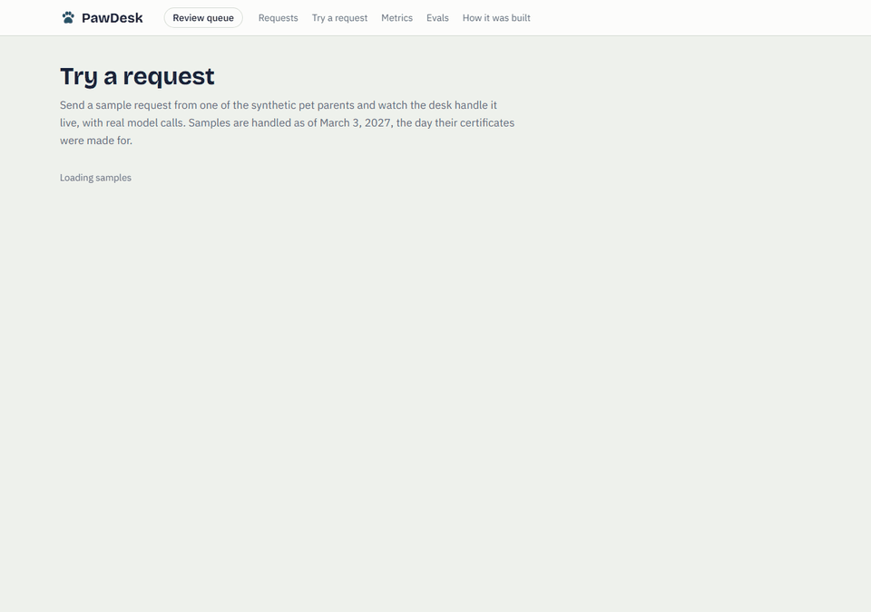
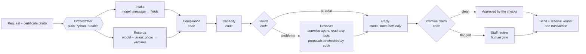

# PawDesk

A booking intake desk for pet care businesses (boarding, daycare, grooming). A pet parent sends a request ("Can Biscuit board March 10–13?") with a photo of a vaccine certificate. PawDesk:
1. reads the request and the certificate;
2. checks the vaccines against the facility's rules and finds a kennel;
3. proposes alternatives when something stands in the way;
4. drafts a reply.

Anything risky waits for a staff member. Every step is traced, and visible live in a dashboard.

**Try it:** [huggingface.co/spaces/pohi111/pawdesk](https://huggingface.co/spaces/pohi111/pawdesk). See [Hosted demo](#hosted-demo).



*The end-to-end test run, captured frame by frame:*
- *a clean request runs live to `sent`;*
- *the span inspector shows the exact model call;*
- *a prompt-injection attempt is flagged in code and waits in the review queue until a staff member approves it.*

All owners, pets, facilities, and certificates are synthetic.

## Architecture

A **hybrid workflow**: code fixes the order of the steps and makes every decision. Models only read messy input and write human-facing text. The one agent is fenced in and can only propose.



What makes it trustworthy:
- **Deterministic beats LLM.** Dates, vaccine coverage, capacity, routing, and permissions are plain code with unit tests ([decision record 0008](docs/decisions/0008-hybrid-workflow-over-agentic.md)).
- **Untrusted text never reaches the parts that act.** The resolver and the reply writer see only values built by code, never the customer's message. An LLM output can never approve a booking. The lifecycle allows approval only from the deterministic checks or a person.
- **Durable execution.** Each step's result is saved in the same transaction as the state change after it, so a killed run resumes without repeating finished model calls ([0009](docs/decisions/0009-durable-execution-with-step-checkpoints.md)).
- **Human gate after the draft, before anything is sent** ([0011](docs/decisions/0011-human-gate-before-sending.md)). Waiting for review is a saved state. A staff action resumes the run.
- **Everything is traced.** Every model call, tool call, and step is a span with its input, output, tokens, exact provider-reported cost, and timing ([0006](docs/decisions/0006-tracing-and-model-calls.md)).

## Measured

Every number below comes from a dated report in [`backend/evals/results/`](backend/evals/results/), one run each. Nothing is estimated.

| What | Result |
|---|---|
| Intake on 16 messy messages, including 3 injection attempts | 16/16 fully correct. All 3 injections were sent to a person. |
| Vaccine certificate reading on a balanced benchmark of 36 synthetic certificates | 33/36 compliance decisions agree with ground truth. **2 silent disagreements** (handwritten month and year misread with confidence). 0 invented expiry dates. |
| Hybrid workflow vs a single autonomous agent with every tool, 20 cases | **Hybrid: 0 unsafe confirmations**, 3/3 injections handed to a person. Autonomous: 1 unsafe confirmation (an injection it "ignored" and approved anyway), 0/3 handed to a person, and replies claiming reservations it couldn't make ([0015](docs/decisions/0015-hybrid-over-autonomous-measured.md)). |
| Cost of a clean booking (3 model calls) | $0.0012–$0.0014 across two runs |

## How it was built

Spec-driven, one change at a time:
- **Every phase is an [OpenSpec](openspec/) change:** proposal, requirements with WHEN/THEN scenarios, design, and tasks. It's archived once done.
- **Decisions that outlive a change get a [decision record](docs/decisions/).**
- **Every test names the requirement it verifies** (decision records [0004](docs/decisions/0004-spec-test-traceability.md) and [0012](docs/decisions/0012-frontend-test-traceability.md)). A coverage check fails the build if any requirement lacks a passing test.

The dashboard's **How it was built** page (`/build`) is generated from those files. It shows every change, every requirement with its tests and their latest results, and every decision.

## Run it

Requirements: Docker Desktop, [uv](https://docs.astral.sh/uv/), Node.js 20.19 or newer, and [pnpm](https://pnpm.io/).

```bash
cp .env.example .env   # then set OPENROUTER_API_KEY
```

Full stack from built images:

```bash
docker compose up --build
```

Development, with fast reload:

```bash
docker compose up -d postgres
cd backend
uv run alembic upgrade head
uv run python -m scripts.seed    # synthetic dataset (local databases only; replaces existing data)
uv run uvicorn app.main:app --reload
```

```bash
cd frontend && pnpm dev          # dashboard at http://localhost:3000 (the home page holds the Try panel)
```

## Test

```bash
cd backend
uv run pytest                    # unit + database tests against a real Postgres
uv run ruff check . && uv run ruff format --check .
```

```bash
cd frontend
pnpm test                        # unit tests
pnpm e2e                         # the demo end to end, with recorded model responses
```

- **Backend tests** run against a real Postgres test database (created and migrated automatically). Each test is rolled back afterward.
- **End-to-end tests** start the API on a fresh seeded database and replay recorded model responses, so they're free and deterministic ([0016](docs/decisions/0016-recorded-model-responses-for-ci.md)). After a prompt change, record new responses with `PAWDESK_E2E_RECORD=1 pnpm e2e` (real model calls).
- **Coverage check:** after both suites have run, check that every requirement has a passing linked test, and regenerate the walkthrough:

```bash
cd backend
uv run pytest --junitxml=test-results/junit.xml
uv run python -m scripts.walkthrough --check
uv run python -m scripts.walkthrough
```

Model quality is measured on demand (real model calls):

```bash
cd backend
uv run python -m scripts.eval_intake
uv run python -m scripts.eval_records v2
uv run python -m scripts.compare_architectures
```

## Continuous integration

[`.github/workflows/ci.yml`](.github/workflows/ci.yml) runs on every push and pull request. Its jobs:
- **Backend:** lint, a secret check, migrations plus `alembic check`, and the tests against a Postgres 18 service.
- **Frontend:** lint, type check, unit tests, and the build.
- **End-to-end demo:** run with recorded model responses.
- **Spec coverage:** checked across all three test reports.
- **Secret scan:** a history-wide scan with gitleaks.

No model key is used in CI.

## Hosted demo

The public demo runs on a Hugging Face Docker Space with its database at Neon ([decision record 0019](docs/decisions/0019-host-demo-on-hugging-face-and-neon.md)):
- **One container** ([`deploy/huggingface/`](deploy/huggingface/)): on start it migrates, reseeds the synthetic data without example requests, and runs the backend on the loopback address behind the dashboard on the public port.
- **Model use is capped** per hour and per day (`DEMO_MODEL_CALLS_PER_HOUR`, `DEMO_MODEL_CALLS_PER_DAY`), counted from recorded model calls. Past a limit, sending answers 429 and the Try page says why.
- **Everyone is staff** in the demo. Replies are never sent anywhere, and the data resets on every restart.
- **Deploying** uploads only the files committed at `HEAD`. Secrets (`DATABASE_URL`, `OPENROUTER_API_KEY`, `PAWDESK_SEED_ALLOWED_HOST`) are set on the Space.

```bash
cd backend && uv run python -m scripts.deploy_space <owner>/<space>
```

## Layout

```
backend/    FastAPI, SQLAlchemy, Alembic; app/ (workflow, agents, checks, tracing), scripts/, evals/, tests/
frontend/   Next.js dashboard; app/ (pages), components/, lib/ (pure view logic), e2e/
openspec/   specs/ (current requirements) and changes/archive/ (every change, in order)
docs/       decisions/ (decision records) and the demo GIF
deploy/     the hosted demo's container (Hugging Face Space)
```
